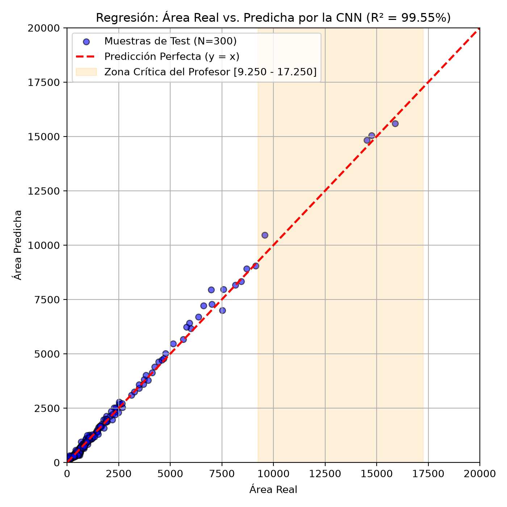
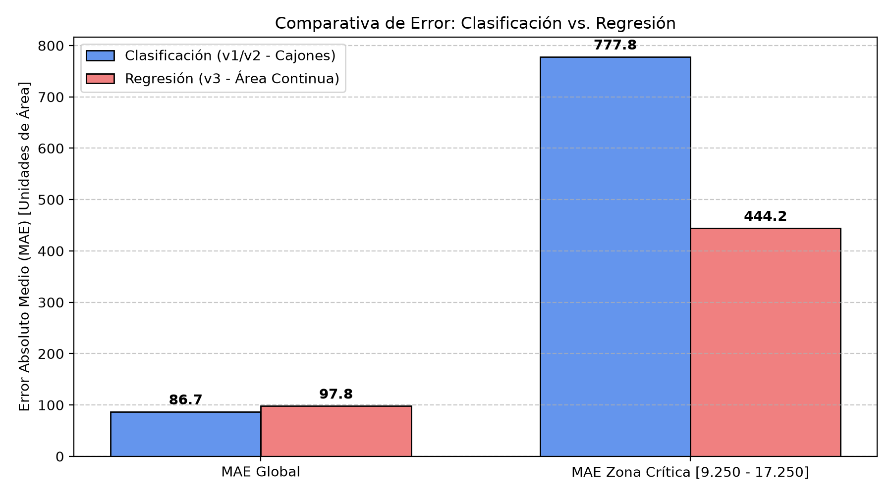

# Proyecto Fashion Peaks: Cuantificación de Fotopicos de Cesio-137 mediante CNN

Este repositorio contiene el desarrollo, experimentación y análisis comparativo para la cuantificación automatizada del área de fotopicos de decaimiento gamma de **Cesio-137 ($^{137}\text{Cs}$, $661.66\text{ keV}$)** en sedimentos lacustres utilizando **Redes Neuronales Convolucionales (CNN)** en PyTorch.

---

## 📌 Resumen del Proyecto

En espectrometría gamma con detectores de germanio hiperpuro (HPGe), el área neta bajo el pico de $661.66\text{ keV}$ es directamente proporcional a la actividad radiactiva de la muestra. Ante grandes volúmenes de espectros, el ajuste gaussiano manual convencional resulta lento y subjetivo. 

Inspirado en el enfoque de visión computacional tipo *Fashion-MNIST*, el proyecto transforma la ventana espectral en torno al pico en imágenes 2D ($32 \times 64$ píxeles) para estimar el área automáticamente.

### Principales Innovaciones y Resultados
1. **Resolución del Colapso en Áreas Altas**: En el enfoque original por clasificación (bines de 500 unidades), la red colapsaba prediciendo erróneamente la clase $16.250$ en el rango $[9.250 - 17.250]$. La reformulación hacia **Regresión Continua de Área con Huber Loss** y **área sombreada** redujo el error en esa región crítica en un **43%** (de $777.8$ a $444.2$ unidades, con un error relativo medio de apenas **3.81%**).
2. **Bondad de Ajuste Global**: El modelo de regresión alcanzó un coeficiente de determinación **$R^2 = 0.9955$ (99.55%)** y un MAE global de **$97.83$ unidades** sobre un conjunto de prueba ciego independiente ($N = 300$).
3. **Reproducibilidad y Rigor Experimental**: Partición formal en Train (70%), Validación (15%) y Test ciego (15%) con semilla fija.

---

## 📊 Gráficos de Resultados

| Regresión: Área Real vs. Predicha ($R^2 = 99.55\%$) | Comparativa de Error: Clasificación vs. Regresión |
|:---:|:---:|
|  |  |

---

## 📁 Estructura del Repositorio

```text
├── README.md                                 <- Este archivo
├── informe_overleaf.pdf                      <- Informe científico completo compilado
├── informe_overleaf/                         <- Código fuente en LaTeX y figuras para Overleaf
│   ├── main.tex
│   └── figures/
├── Fashion_Peaks_Colab/                      <- Entorno unificado y autocontenido (Local / Colab)
│   ├── 01_nuevo_crear_corpus_colab.ipynb     <- Generador de espectros sintéticos Monte Carlo
│   ├── 02_nuevo_entrenamiento_clasificacion.ipynb <- Entrenamiento de clasificación (binned)
│   ├── 02_nuevo_entrenamiento_regresion.ipynb     <- Entrenamiento de regresión continua (v3)
│   ├── 03_nuevo_evaluar_y_metricas.ipynb     <- Evaluación masiva y comparativa
│   ├── modelos_guardados/                    <- Checkpoints entrenados (.pth)
│   ├── fileBase_2000x1900.dat                <- Espectros Monte Carlo de fondo natural
│   ├── fileCesio_2000x1900.dat               <- Espectros Monte Carlo de Cesio-137
│   ├── imagenes_entrenamiento/               <- 2.000 imágenes para clasificación
│   └── imagenes_entrenamiento_regresion/     <- 2.000 imágenes para regresión
├── Fashion_Peaks_Colab.zip                   <- Paquete comprimido para Google Drive (11 MB)
├── informe_overleaf.zip                      <- Paquete listo para importar en Overleaf
├── Fashion_Peaks-20250510T134326Z-1-001/     <- Materiales originales del docente (Mayo 2025)
└── Fashion_Peaks-20250513T144737Z-1-001/     <- Actualización de materiales del docente
```

---

## 🚀 Cómo Ejecutar

### Opción 1: En Visual Studio Code (Local Linux)
1. Clonar el repositorio y crear un entorno virtual:
   ```bash
   git clone <URL_DEL_REPOSITORIO>
   cd nuevofashionpeaks
   python3 -m venv .venv
   source .venv/bin/activate
   pip install torch torchvision --index-url https://download.pytorch.org/whl/cpu
   pip install pandas numpy matplotlib scikit-learn tqdm ipykernel
   ```
2. Abrir en VS Code:
   ```bash
   code .
   ```
3. Abrir `Fashion_Peaks_Colab/02_nuevo_entrenamiento_regresion.ipynb`, seleccionar el kernel `.venv` y ejecutar.

### Opción 2: En Google Colab
1. Subir la carpeta `Fashion_Peaks_Colab` a Google Drive en `Mi unidad`.
2. Abrir cualquiera de los notebooks con Google Colaboratory.
3. Activar GPU: `Entorno de ejecución` > `Cambiar tipo de entorno de ejecución` > **T4 GPU**.
4. Ejecutar todas las celdas.

---

## 📄 Informe Técnico
El documento completo con la justificación física, matemática y de arquitectura de red se encuentra en [`informe_overleaf.pdf`](informe_overleaf.pdf), o en la carpeta [`informe_overleaf/`](informe_overleaf/) para su edición en Overleaf.
